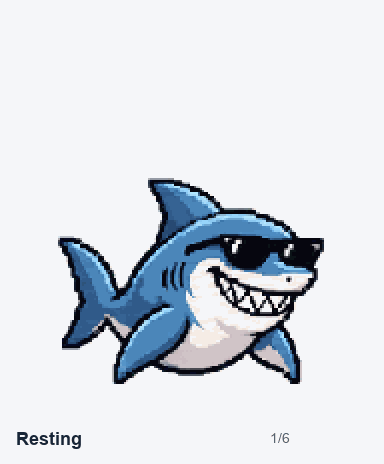
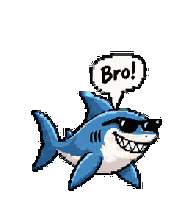

# Bro Shark for Codex

A cool pixel shark with black sunglasses, a toothy smile, swimming fin strokes, and **Bro!** comic action bubbles.



## Install into Codex

Download this repository with **Code → Download ZIP**, extract it, and open a terminal in the extracted folder. Python 3.9 or later is needed for the installer; no packages or API key are required.

On Windows:

```powershell
py tools/verify.py
py tools/install.py --dry-run
py tools/install.py
```

On macOS or Linux:

```bash
python3 tools/verify.py
python3 tools/install.py --dry-run
python3 tools/install.py
```

The installer copies only `pet.json` and the compatible sprite sheet into `$CODEX_HOME/pets/bro-shark/`, using `~/.codex` when `CODEX_HOME` is unset. It does not change settings, select a pet, or replace an existing different pet.

In an interactive Codex CLI session, enter:

```text
/pets bro-shark
```

For a desktop app build with Pets, open **Settings → Pets**, refresh the picker if offered, and select **Bro Shark**. If that build does not discover the local bundle, use the assisted import instructions in [the installation guide](docs/INSTALL.md#desktop-assisted-import).

See [the full installation guide](docs/INSTALL.md) for manual copying, custom Codex directories, troubleshooting, and supported surfaces.

## Which file should I use?

| File | Use |
| --- | --- |
| [`pets/bro-shark/`](pets/bro-shark/) | Ready-to-install local Codex bundle: manifest plus a 1536×1872 nine-row sprite sheet. |
| [`assets/bro-shark-v2.png`](assets/bro-shark-v2.png) | Original 1536×2288 eleven-row master with all sixteen look directions. For tools that explicitly support this extended format. |
| [`previews/`](previews/) | Action GIFs, a look loop, and pose sheets for review. |

The current OpenAI Codex CLI loader expects the nine-row dimensions. The compatible export contains the original first nine rows **without resampling or redrawing**. All nine action states remain intact. The two additional look rows are preserved in the extended master but are not installed by default.



## Included behavior

- Calm idle with a visible grin and shades.
- Rightward and leftward swimming with alternating fin strokes.
- Greeting, jump, failure reaction, waiting, working, and review poses.
- Readable **Bro!** speech bubbles during action frames; quiet idle has no bubble.
- Sixteen additional look poses in the extended master.

The host decides which state to play. Codex CLI uses work-status animations; floating movement and dragging belong to desktop interfaces that support them. The files add artwork, not new app controls.

## Validation and provenance

The extended master passed structural validation, the bundled pet quality gate, three independent blind direction reviews, and Pets service preflight. The local Codex export is a lossless crop of those approved action rows and is checked separately for the compatible grid. See [validation notes](docs/VALIDATION.md) and [the layout specification](docs/SPRITE-LAYOUT.md).

Artwork was generated with OpenAI image generation and refined through user review. Checksums and dimensions are recorded in [`assets.json`](assets.json).

## What may be missing or uncertain

- The repository is private for review. Its existing [MIT license](LICENSE) is preserved; changing visibility remains an owner decision.
- Local manifest compatibility is grounded in the [OpenAI Codex loader source](https://github.com/openai/codex/blob/13ab0b254e7b9ed0ab473d38d978fa100bf417ae/codex-rs/tui/src/pets/model.rs). Desktop discovery varies by app build; follow the assisted route if needed.
- Installation checks do not substitute for testing live dragging or playback on every operating system.
- GIF previews are included; there is no MP4 export.

For current platform behavior, see [OpenAI's Pets documentation](https://learn.chatgpt.com/docs/pets).
